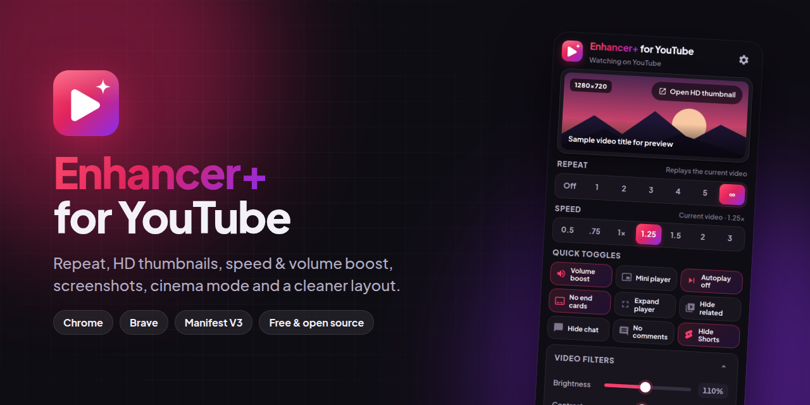
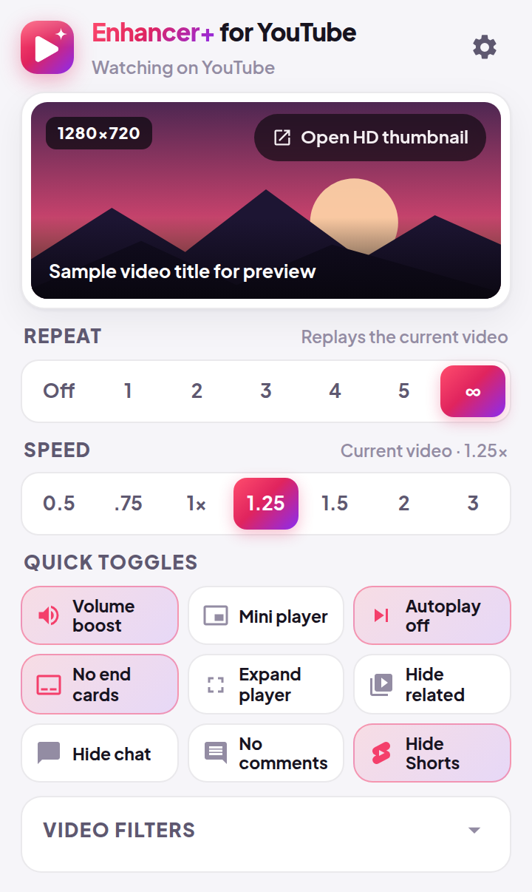
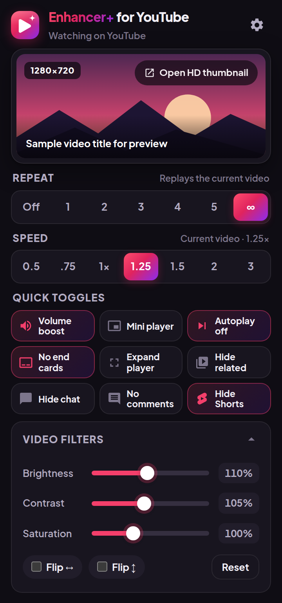
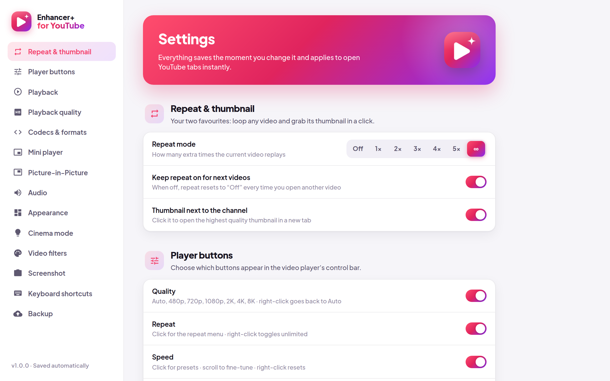
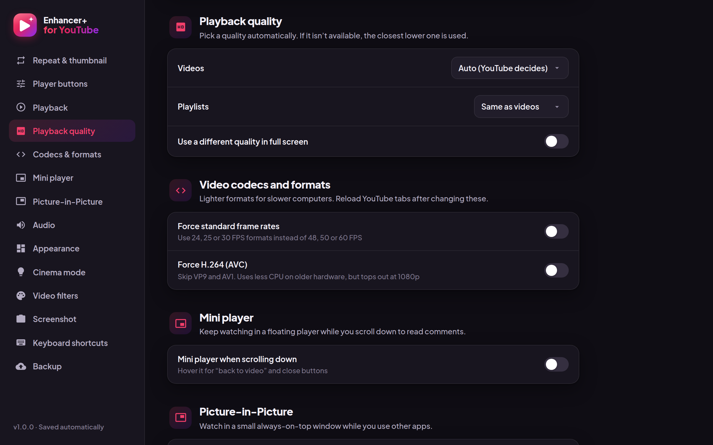

# Enhancer+ for YouTube

**Repeat, HD thumbnails, speed & volume boost, screenshots, cinema mode, filters, and a cleaner YouTube.**

[**🌐 Website**](https://taoufikgfx.github.io/youtube-enhancer/) · [**⬇️ Download**](https://github.com/TaoufikGFX/youtube-enhancer/releases/latest) · [**📝 Changelog**](CHANGELOG.md)

## ✨ Features

- 🔁 **Repeat**: a player button to replay a video 1–5 times or forever
- 🖼️ **HD thumbnails**: open any video's best-quality thumbnail in one click
- ⏩ **Speed control**: presets, scroll to fine-tune, and a default speed
- 🎞️ **Quality**: preferred quality for videos, playlists, full screen, and the mini player
- 🧩 **Codecs**: force 30 FPS and/or H.264 for lighter playback on older hardware
- 🔊 **Volume boost**: up to 6× with a limiter, plus scroll-to-change volume
- 📸 **Screenshots**: full-resolution frames, downloaded, copied, or both
- 🎬 **Cinema mode, Picture-in-Picture, and an expanded player** that fills the window
- 📺 **Mini player**: keeps playing in a corner while you scroll
- 🧹 **Cleaner layout**: hide Shorts, comments, chat, related videos, and end cards; videos per row; autoplay off
- 🎨 **Video filters**: brightness, contrast, saturation, hue, and more, plus flip
- ⌨️ **Keyboard shortcuts** for the most-used actions
- 💾 **Backup**: export and import all your settings
- 🌗 **Light and dark mode**, follows your system

## 📸 Screenshots

| Popup (light) | Popup (dark) |
|:---:|:---:|
|  |  |

| Settings | Settings (dark) |
|:---:|:---:|
|  |  |

## 📦 Installation

1. Download `youtube-enhancer-v1.0.1.zip` from the [latest release](https://github.com/TaoufikGFX/youtube-enhancer/releases/latest) and extract it.
2. Open `chrome://extensions` (Chrome) or `brave://extensions` (Brave).
3. Turn on **Developer mode** (top right), click **Load unpacked**, and select the extracted folder (the one that contains `manifest.json`).

Requires Chrome or Brave 120 or newer.

## 🚀 Usage

- **Player buttons** appear in YouTube's control bar: quality, repeat, speed, volume boost, screenshot, cinema, expand, and PiP. Choose which ones you want in the settings.
- **Toolbar popup**: see the current video's thumbnail, set repeat and speed, and flip quick toggles.
- **Settings page**: click the gear in the popup (or right-click the toolbar icon → *Options*). Everything saves and applies instantly.
- **Right-click** any YouTube video link → *Open video thumbnail (best quality)*.

| Shortcut | Action |
|---|---|
| `Alt+Shift+R` | Toggle repeat (off / unlimited) |
| `Alt+Shift+S` | Take a screenshot |
| `Alt+Shift+C` | Toggle cinema mode |
| `Alt+Shift+T` | Open the thumbnail in best quality |

You can change these and assign more (speed, boost, PiP, expand, settings) at `chrome://extensions/shortcuts`.

## 🔐 Permissions

| Permission | Why it's needed |
|---|---|
| `storage` | Saves your settings locally in the browser |
| `unlimitedStorage` | Removes the local storage quota so saving settings never fails |
| `tabs` | Reads the active tab's address and title to show the current video in the popup, opens thumbnails next to it, and sends shortcuts to the YouTube tab |
| `contextMenus` | Adds "Open video thumbnail (best quality)" to the right-click menu |
| `clipboardWrite` | Copies screenshots to the clipboard when you choose "Copy" |
| `*://*.youtube.com/*` | Runs the enhancements on YouTube pages |
| `*://youtu.be/*` | Recognizes short YouTube links for the right-click thumbnail menu |
| `*://i.ytimg.com/*` | Checks which thumbnail resolution exists, so it can open the best one |

**Privacy:** no analytics, no tracking, no accounts, no external servers. Settings stay in your browser; the only network request the extension makes itself is checking thumbnail sizes on YouTube's image server.

## ❓ FAQ

<b>Is this on the Chrome Web Store?</b>

Not yet. For now, install it from the release zip as described above.

<b>Does it work in other Chromium browsers (Edge, Opera, Vivaldi)?</b>

It's built and tested for Chrome and Brave, but it's a standard Manifest V3 extension, so other Chromium browsers should work too.

<b>The codec or frame-rate options don't seem to apply.</b>

They take effect when YouTube loads. Reload your YouTube tabs after changing them.

<b>How do I update?</b>

Download the new release, replace the old folder with the new one, and click the reload icon on the extension's card. Your settings are kept. You can also export a backup from the settings page first.

<b>Is this an official YouTube product?</b>

No. It's an independent, open-source project and is not affiliated with or endorsed by YouTube or Google.

## 📝 Changelog

See [CHANGELOG.md](CHANGELOG.md).

## 📄 License

[MIT](LICENSE) © TaoufikGFX. The bundled Plus Jakarta Sans font is under the [SIL Open Font License](extension/assets/fonts/OFL.txt).

YouTube is a trademark of Google LLC. This project is not affiliated with Google.

## ☕ Support

If this extension saves you time, consider buying me a coffee. It helps me keep building free tools.

## 🌍 More from me

Website: [taoufikmouadab.com](https://taoufikmouadab.com) · GitHub: [@TaoufikGFX](https://github.com/TaoufikGFX)
